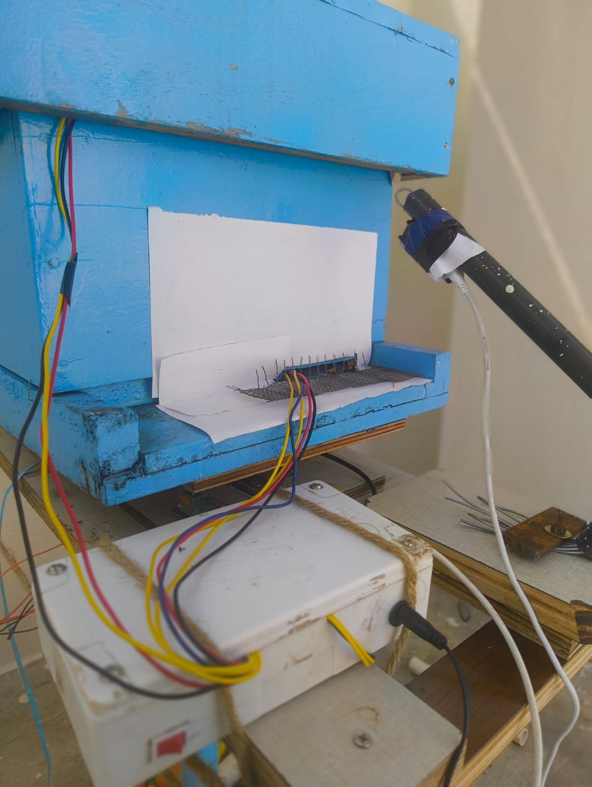
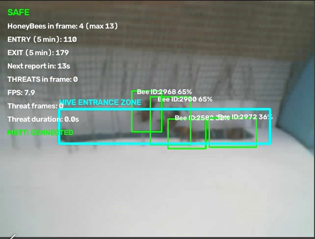
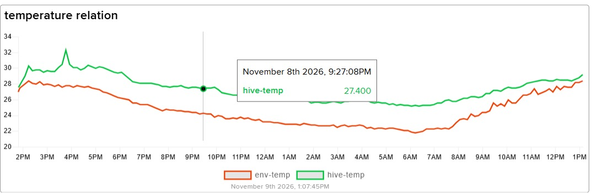
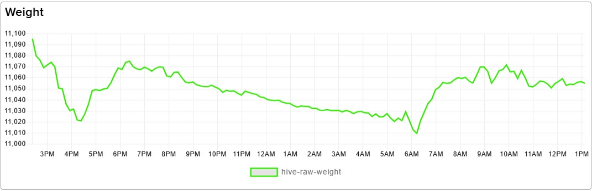
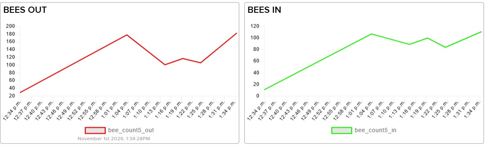
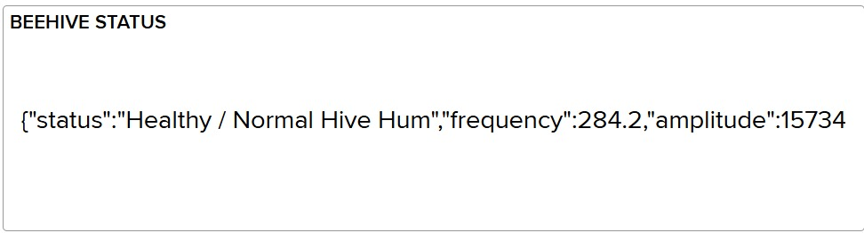
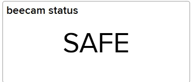

# Multimodal AI-Based Beehive Surveillance and Health Monitoring System

An IoT + computer-vision system that watches a beehive from three angles at once:
**weight and climate** (load cell, temperature, humidity), **sound** (microphone + FFT of the colony hum)
and **vision** (ESP32-CAM + YOLO for bee counting and threat detection). All results are pushed to an
[Adafruit IO](https://io.adafruit.com) dashboard.

<p align="center">
  
  
</p>

## Features

| Modality | What it does |
|---|---|
| **Weight** | NAU7802 24-bit ADC + load cells, saved tare offset in flash, temperature drift compensation using outside-air temperature |
| **Climate** | Two DHT22 sensors: inside the hive and outside, for the inside/outside temperature relation |
| **Acoustics** | INMP441 I2S microphone, 1024-point FFT at 16 kHz, 200-600 Hz bee band, classifies *Healthy / Agitated / Empty-silent* |
| **Vision** | ESP32-CAM MJPEG stream, YOLO + ByteTrack on a laptop, bees entering/leaving a virtual entrance zone |
| **Threat detection** | Flags ants, hornets, wasps and wax moths; alert is raised after 3 continuous seconds and repeated while the threat persists |
| **Dashboard** | Adafruit IO feeds over MQTT for weight, temperature, humidity, hive status, bee traffic and threat status |
| **Low power** | Sensor node deep-sleeps between cycles; Wi-Fi is switched off during weighing to avoid supply noise |

## System architecture

```
                  ┌──────────────────────────────┐
  Load cell ─────►│                              │
  DHT22 x2  ─────►│  ESP32 sensor node (BHMS)    │──Wi-Fi/MQTT──┐
  INMP441   ─────►│  deep sleep between cycles   │              │
                  └──────────────────────────────┘              ▼
                                                        ┌───────────────┐
                  ┌──────────────┐  MJPEG   ┌─────────┐ │ Adafruit IO   │
  Hive entrance ─►│  ESP32-CAM   │─────────►│ Laptop  │►│ dashboard     │
                  └──────────────┘  stream  │ YOLO +  │ └───────────────┘
                                            │ tracker │
                                            └─────────┘
```

The ESP32-CAM only streams video. Detection, entry/exit counting, alert logic and MQTT publishing for the
vision side run in Python on a laptop (`threat_detection/detector.py`).

## Repository layout

```
.
├── firmware/
│   ├── bhms_sensor_node/      # weight + climate + audio node -> Adafruit IO
│   └── esp32_cam_stream/      # ESP32-CAM live video stream
├── threat_detection/
│   ├── detector.py            # YOLO + ByteTrack + counting + MQTT
│   ├── requirements.txt
│   └── weights/               # put best.pt here (not committed)
├── docs/
│   ├── wiring.md
│   └── images/                # photos and dashboard screenshots
├── LICENSE
└── README.md
```

## Hardware

- ESP32 (WROOM-DA) for the sensor node
- NAU7802 24-bit load-cell ADC and load cells (hive platform scale)
- 2x DHT22 (inside hive, outside air)
- INMP441 I2S MEMS microphone
- ESP32-CAM (AI-Thinker style) for the entrance camera
- Laptop for YOLO inference

Pin tables are in [docs/wiring.md](docs/wiring.md).

## Getting started

### 1. Sensor node (BHMS)

1. Install these Arduino libraries: `arduinoFFT` (v2+), `HX711`, `DHT sensor library`, `Adafruit MQTT Library`, `Adafruit NAU7802`.
2. In `firmware/bhms_sensor_node/`, copy `secrets.h.example` to `secrets.h` and fill in your Wi-Fi and Adafruit IO details.
3. Create these feeds on Adafruit IO: `hive-status`, `hive-weight`, `hive-raw-weight`, `hive-temp`, `hive-humid`, `env-temp`.
4. Flash `bhms_sensor_node.ino`. On first boot the node tares with an **empty** platform and stores the offset in flash.
   Pull GPIO 14 LOW to re-tare later.

### 2. ESP32-CAM

1. Start from the Arduino **CameraWebServer** example so that `app_httpd.cpp` and `board_config.h` are present, then add `esp32_cam_stream.ino`.
2. Copy `secrets.h.example` to `secrets.h` and add your Wi-Fi details.
3. Flash it and note the IP printed in the serial monitor. The stream is at `http://<IP>:81/stream`.

### 3. Threat detection (laptop)

```bash
cd threat_detection
python -m pip install -r requirements.txt

# Windows (PowerShell)
$env:BEE_CAMERA_URL = "http://<ESP32_CAM_IP>:81/stream"
$env:AIO_USERNAME   = "your_adafruit_username"
$env:AIO_KEY        = "your_adafruit_io_key"

python detector.py        # press Q in the video window to quit
```

Place your trained `best.pt` in `threat_detection/weights/` or set `BEE_MODEL_PATH`.
Without Adafruit credentials the detector still runs locally and just skips publishing.

The entrance zone is set by `ENTRANCE_X1/Y1/X2/Y2` in `detector.py` (coordinates for a 640x480 frame).

## How the status logic works

**Acoustic status** (every cycle, about 60 s of audio): frames whose strongest FFT peak is above the amplitude
threshold and inside 200-600 Hz count as bee sound. Peaks at 200-300 Hz vote *healthy*, 300-450 Hz vote *agitated*.
No valid bee sound with silence reported means *Empty / Silent Hive*.

**Vision status**: tracked bees crossing the entrance zone are counted as entries or exits. A threat class
(ant, hornet, wasp, wax moth) present for 3 continuous seconds publishes `THREAT DETECTED` to the
`bee-hive-detection` feed. `SAFE` is published at most once a minute while bees are moving and no threat is present.

## Results

<p align="center">
  
  
</p>
<p align="center">
  
</p>
<p align="center">
  
  
</p>

- The temperature chart shows the hive staying warmer than the outside air through a full day-night cycle.
- The weight chart shows the daily pattern of foraging (weight dips) and return.
- The status tiles show the live acoustic classification and the camera's SAFE / THREAT state.

## Security note

Wi-Fi passwords and Adafruit IO keys are **not** stored in this repository. Firmware reads them from a local
`secrets.h` (git-ignored) and the Python script reads them from environment variables.

## Future work

- Publish the entry/exit counts from the Python detector alongside the status feed
- Per-band acoustic energy (200-600 Hz in 50 Hz bins) for queen-piping and swarming detection
- On-device or Raspberry Pi inference so the laptop is no longer needed
- Solar power and a weatherproof enclosure

## License

MIT, see [LICENSE](LICENSE).
